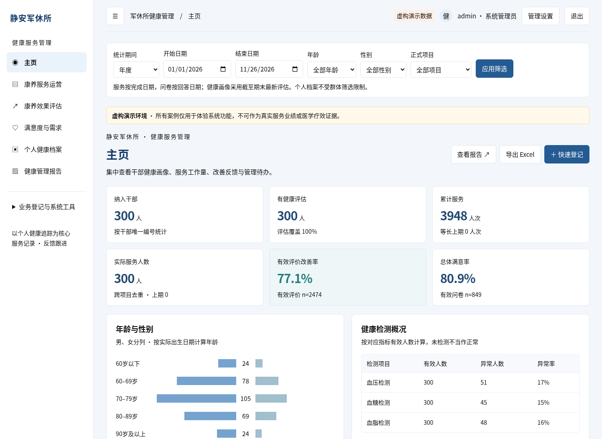

# 静安军休所健康管理系统 · V2

按《军休所智慧康养信息化系统优化方案 V2》实现，保留原有建档、健康评估、现场与上门预约、历史理疗附件、查询导出、备份恢复和审计功能。首页调整为白底浅蓝的六个主模块；原业务入口收纳在侧栏“业务登记与系统工具”中。



## Windows 启动

1. 下载本版本 ZIP 并**完整解压**到可写目录，例如 `D:\health_agent_v2`。
2. 安装 64 位 Python **3.10–3.14**，推荐 **3.12**，勾选 **Add Python to PATH**。
3. 双击 **`启动医疗系统.bat`**。首次启动联网安装依赖，随后自动打开 `http://127.0.0.1:5000`，默认已带 **300 位虚构干部的完整案例**。
4. 登录 **`admin` / `123456`**。主页默认显示案例所属的 2026 年度，截至 11 月 26 日。

本版按要求将下载包的默认 `medical_system.db` **整体替换为新案例库，原业务记录已移出活动数据库**。共有 300 位干部、600 份健康评估、3,948 次完成服务、8,100 条个人检测指标、3,343 条体验/阶段评价和 849 份问卷，覆盖六个主模块及原业务工具。每位干部均有明确出生日期和男/女性别，年龄图表、筛选和报告不再显示“未知”。

**已有安装需要覆盖数据时**：先关闭系统，把新版代码放入原项目目录，双击 **`覆盖为300条案例并启动.bat`**。它会先在实际数据目录的 `database_backups/` 保存 `before_300_cases_*.db`，再用 300 位虚构案例替换整个数据库（包括账号设置），登录恢复为上述演示账号。若配置了 `HEALTH_AGENT_DATA_DIR`，覆盖的是该目录中的数据库。后续日常启动使用 `启动医疗系统.bat`，保留你新增和修改的记录。

初次启动自动生成本机 `.secret_key`，无需手动配置 `SECRET_KEY`。可选 `启动V2演示系统.bat` 会在独立的 `demo_v2_data/` 生成同一套 300 人案例，端口 5050；旧版 100 人演示库会先备份再升级一次，后续启动保留修改。

| 演示账号 | 密码 | 权限 |
| --- | --- | --- |
| admin | 123456 | 管理员，完整操作 |
| demo_manager | Demo2026! | 脱敏群体统计及汇总报告，无个人下钻 |
| demo_operator | Demo2026! | 服务、反馈、问卷、跟进登记，无导出和专业判断权限 |
| demo_professional | Demo2026! | 个人检测、专业管理分层、服务与跟进、授权报告 |
| demo_resident | Demo2026! | 仅查看并导出演示干部 001 本人获授权档案 |

正式使用可在“管理设置 → 管理账号授权”设置账号、个人访问和导出权限。案例均为固定 2026 年虚构数据，页面、报告和导出均有演示标记；不能作为真实业绩或医学疗效证据。

## 本次改版

- **主页**：合并原综合驾驶舱和群体画像，集中展示人群结构、病史症状、检测概况、服务量、改善反馈及待办；移除专业管理分层、慢病共存和病史共存矩阵展示。
- **康养服务运营**：严格六个板块——核心指标、设备使用、月度趋势、人数与人次、故障维修、上门服务。
- **康养效果评估**：单次反馈与阶段复评分开；有效评价分母、覆盖率、使用次数关联及样本量；检测类单列报告和异常跟进。
- **满意度与需求**：总体及五维满意度、多选需求、意见负责人、完成日期及反馈闭环。
- **个人健康档案**：本人检测趋势、专业参考范围、前后评分配对、服务与检测时间轴、随访计划；可先登记预约与基线，再完成服务及复评。
- **健康管理报告**：运营、画像、成效和个人四类报告，支持浏览器打印/保存 PDF 和 Excel 导出，沿用页面统计函数。

正式项目仅为 **艾灸、高压氧仓、听力测试、红外理疗、荧光免疫分析仪、按摩机器人**。上门是渠道。旧别名先归档待核验，在“管理设置 → 查看迁移与项目核验”确认后映射；历史业务记录保留。本版案例库包含 12 台虚构设备；使用新的空数据目录开展正式业务时，按实际资产登记，应用启动不会自动导入案例。

界面小字统一放大为 14–16 像素，说明、表格、图例和表单使用黑色文字，适配桌面与手机。超过 50 行的明细表自动分页，Excel 仍导出完整记录；个人档案打开后自动展示首位干部，可搜索或切换全部 300 人。

## 文档与验证

- [300 位案例清单与数量](cases-300.json)
- [升级、统计口径、权限、迁移回滚及验收对照](docs/v2-acceptance.md)
- [Windows 启动排障](docs/windows-startup.md)
- [原版业务功能参考](docs/legacy-readme.md)（历史文档中的依赖和启动说明以本页为准）

项目无需 Node.js 或前端构建；日常运行仅需 Python、Flask、SQLite 及 `requirements.txt` 中依赖。开发环境可运行：

```bash
python -m pip install -r requirements.txt
python -m unittest discover -s tests -v
python launch.py --no-gui --no-browser
```

命令行生成独立新案例库（目录中无数据库时）：

```bash
python seed_demo_v2.py --data-dir ./demo_v2_data
```

覆盖已有目录请加 `--replace`，例如 `python seed_demo_v2.py --data-dir ./demo_v2_data --replace`；旧库会先备份。不加此参数不会覆盖普通已有库。请先停止该目录对应的系统进程。
